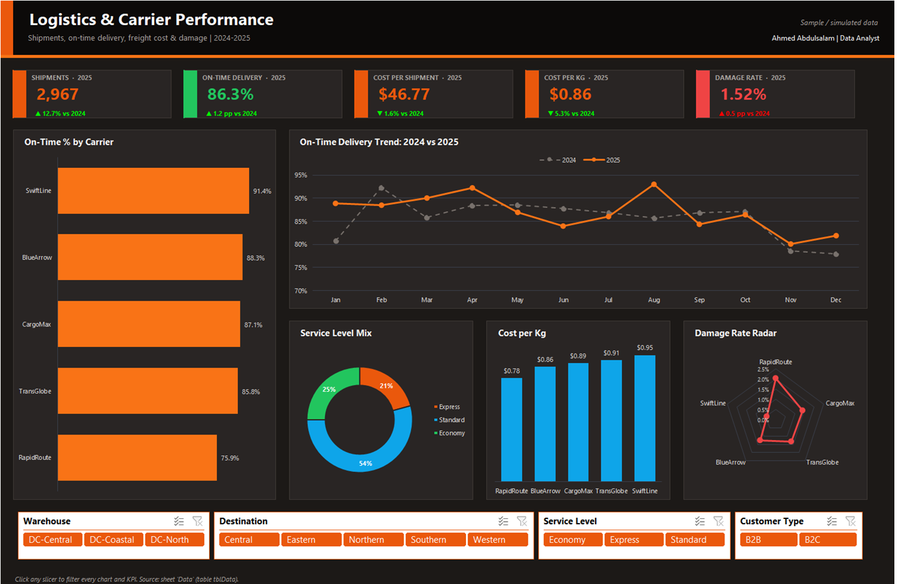

# Logistics & Carrier Performance

**Sector:** Supply Chain / Logistics  |  **Tools:** Excel (PivotTables, PivotCharts, Slicers)  |  **Data:** 5,600 rows, simulated

> A distributor ships from three distribution centres with five carriers. Customer complaints about late and damaged deliveries are rising, and procurement must decide which carriers to keep for 2026.

*The Power BI version of this project is in [powerbi-dashboards](https://github.com/ahmedboezz/powerbi-dashboards/tree/main/04-logistics-carriers).*

## Excel dashboard

## Business questions

1. How many shipments did we send and what share arrived on time?
2. Which carrier gives the best balance of cost, speed and damage?
3. How does peak season affect delivery performance?
4. Which destination regions are hardest to serve?
5. What does freight cost per kg and per shipment?

## Key insights

- Volume grew 12.7% in 2025 (2,633 to 2,967 shipments); on-time delivery moved from 85.1% to 86.3%.
- SwiftLine is the most reliable carrier (91.4% on time); RapidRoute is the cheapest per kg ($0.78) but delivers only 75.9% on time and has the highest damage rate (2.0%).
- Peak season hurts service: on-time falls to 79.8% in Nov-Dec vs 87.5% in the rest of the year.
- Southern and Northern regions have the lowest on-time rates (81.8%, 82.9%).
- Late shipments represent $36.4K of freight spend over two years, with knock-on customer service costs.

## Recommendations

- Move peak-season and Northern/Southern volume from RapidRoute to SwiftLine or BlueArrow; the saving per kg does not cover the service and damage cost.
- Agree an on-time SLA with penalties (e.g. 92%) in the 2026 carrier contracts.
- Book extra peak capacity in October and add one buffer day to promised dates in Nov-Dec for remote regions.
- Track damage claims by carrier monthly and require packaging audits above 1.5%.

## What is inside

| File | Contents |
|---|---|
| `Excel/Logistics_Shipments_Dashboard.xlsx` | **Dashboard** (KPI cards: Shipments, On-time delivery, Cost per shipment, Cost per kg, Damage rate; 5 PivotCharts; slicers that filter everything) · **Pivots** (6 PivotTables on one cache) · **Data** (clean Excel table) · **About** (problem, insights, data dictionary) |
| `screenshots/` | Dashboard images |

## Excel techniques

- One Excel Table (`tblData`) feeds a single pivot cache, so one *Refresh All* updates every PivotTable, chart and KPI.
- Calculated fields for ratios (OnTimeRate, CostPerKg, CostPerShipment, DamageRate).
- KPI cards read the pivots with `GETPIVOTDATA` and show the change vs the previous year with colour-coded number formats (green = good).
- Slicers are connected to every PivotTable through *Report Connections*.
- Workbook theme colours, PivotChart styling, hidden gridlines and a print-ready landscape layout.

---
*All data is simulated for portfolio purposes; company names are fictional.*  
*Prepared by Ahmed Abdulsalam - Data Analyst.*

---
© 2026 Ahmed Abdulsalam. All rights reserved. See [LICENSE](../LICENSE).
