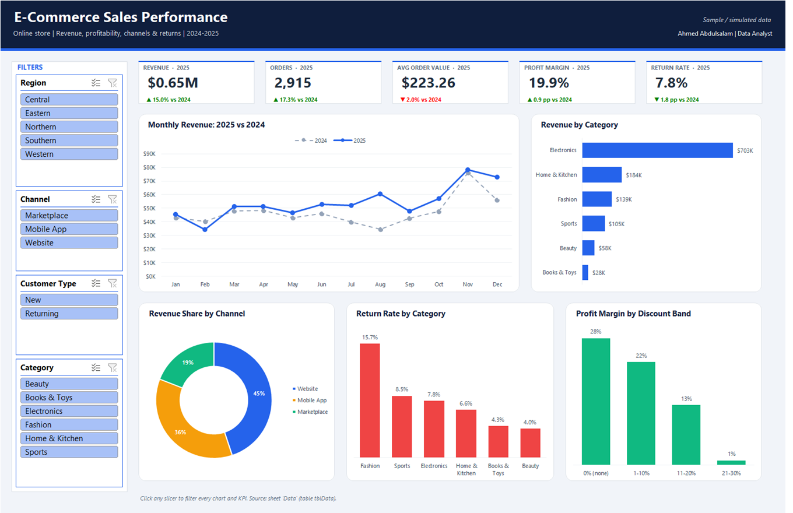
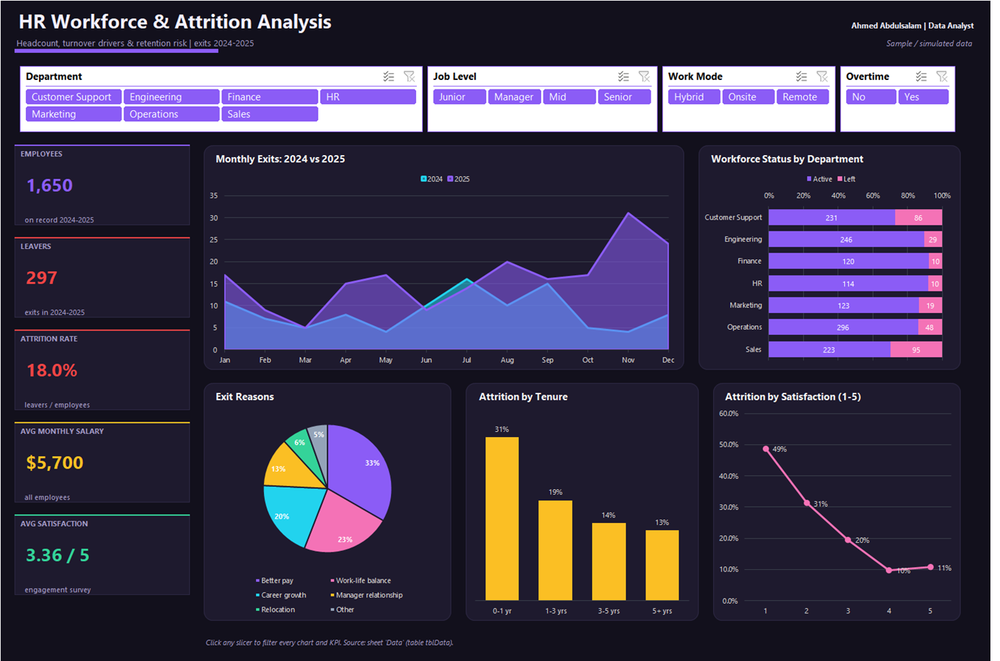
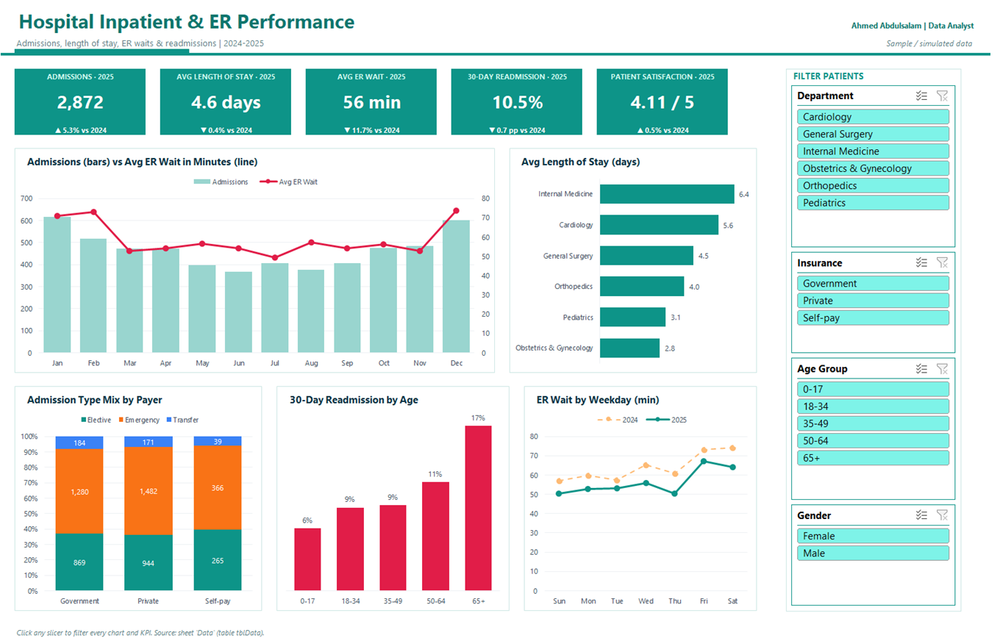
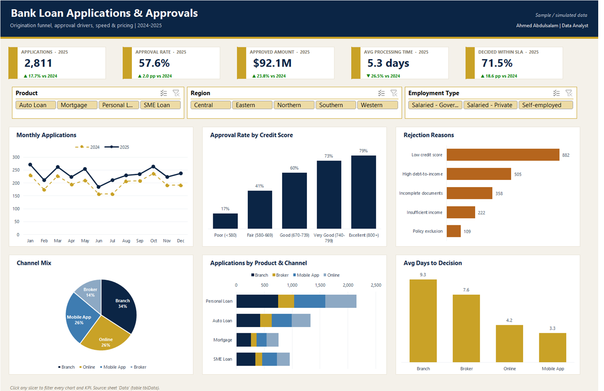
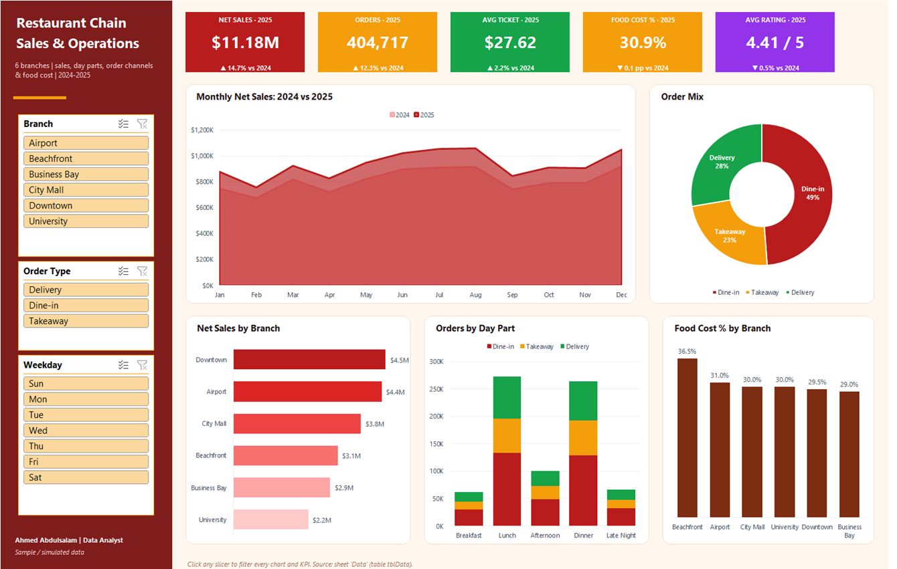

# Excel Dashboards

Six interactive Excel dashboards, one per industry. Each workbook goes from a clean data table to PivotTables, an interactive dashboard and a written insights sheet. Every dashboard has its own layout and theme.

| # | Project | Sector |
|---|---|---|
| 1 | [**E-Commerce Sales Performance**](01-ecommerce-sales) | E-commerce / Retail |
| 2 | [**HR Workforce & Attrition Analysis**](02-hr-attrition) | Human Resources |
| 3 | [**Hospital Inpatient & ER Performance**](03-hospital-performance) | Healthcare |
| 4 | [**Logistics & Carrier Performance**](04-logistics-carriers) | Supply Chain / Logistics |
| 5 | [**Bank Loan Applications & Approvals**](05-bank-loan-applications) | Banking / Finance |
| 6 | [**Restaurant Chain Sales & Operations**](06-restaurant-chain-sales) | Food & Beverage / Hospitality |

**Techniques:** Excel Tables · PivotTables with calculated fields · PivotCharts · Slicers linked through Report Connections · KPI cards with `GETPIVOTDATA` · conditional number formats · print-ready dashboard layout.

> **About the data:** all datasets are simulated to mirror real business systems and include realistic data-quality issues. Company names are fictional. My client work can't be published, so these projects rebuild the same kind of business problems with data I can share.

## Preview

### E-Commerce Sales Performance

### HR Workforce & Attrition Analysis

### Hospital Inpatient & ER Performance

### Logistics & Carrier Performance

### Bank Loan Applications & Approvals

### Restaurant Chain Sales & Operations

More projects: [Power BI](https://github.com/ahmedboezz/powerbi-dashboards) · [SQL](https://github.com/ahmedboezz/sql-projects) · [Python](https://github.com/ahmedboezz/python-data-analysis)

---
**Ahmed Abdulsalam** · Data Analyst · Jeddah, Saudi Arabia · a@ezzprx.com · [LinkedIn](https://linkedin.com/in/ahmedboezz)

---
© 2026 Ahmed Abdulsalam. All rights reserved. See [LICENSE](LICENSE).
